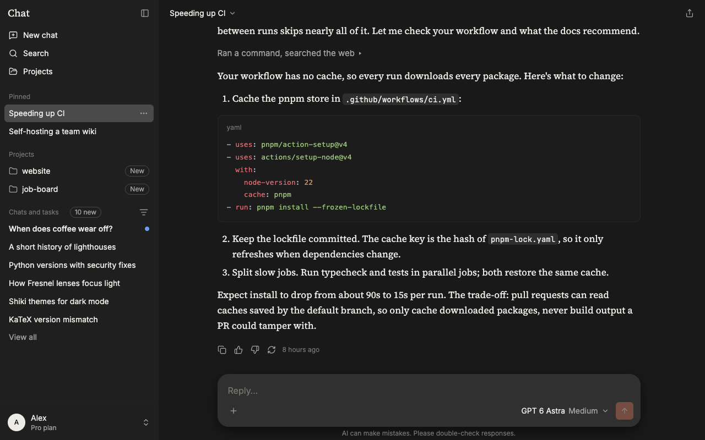
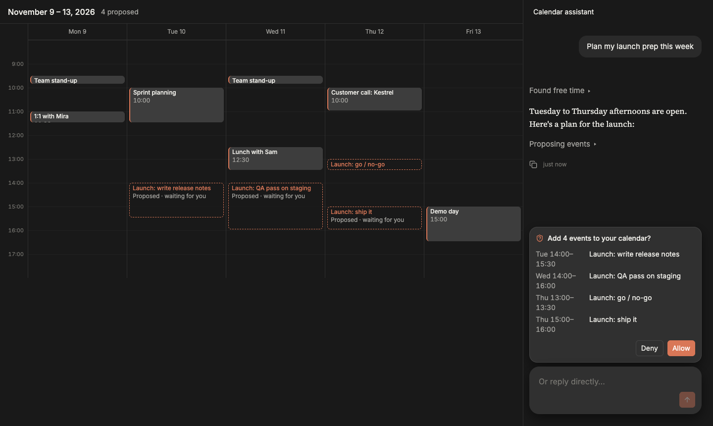

# agentic-ui-kit

React components for LLM chat and agentic apps: streaming replies with Markdown, math and code; thinking and
tool-call rows; approvals; tools that change the page around the chat. Themed entirely with CSS variables, so it
can take on your app's look.

> [!WARNING]
> **This is AI-written slop. You probably shouldn't use it.**
> It isn't reviewed or hardened, the API will change without notice, and it may stop being maintained at
> any time. If you still want to try it, pin an exact version, or fork it and treat the code as your own.



## Install

```sh
npm install agentic-ui-kit
```

Requires React 19. React is an optional peer dependency, so a server can use `agentic-ui-kit/core` on its own.

| Import                       | What it is                                                                     |
| ---------------------------- | ------------------------------------------------------------------------------ |
| `agentic-ui-kit`             | React components and hooks                                                     |
| `agentic-ui-kit/core`        | Types, stream events, the message reducer, SSE helpers. No React, no DOM.      |
| `agentic-ui-kit/styles.css`  | Precompiled styles, for apps without Tailwind                                   |
| `agentic-ui-kit/tailwind.css`| The same styles as Tailwind v4 source, for apps that use Tailwind              |

### Install from source

```sh
git clone https://github.com/bushshrub/agentic-ui-kit
cd agentic-ui-kit && pnpm install
pnpm --filter agentic-ui-kit pack        # builds and writes agentic-ui-kit-0.1.0.tgz here
cd ../your-app && npm install ../agentic-ui-kit/agentic-ui-kit-0.1.0.tgz
```

## Quick start

```tsx
import { ChatView, sseTransport, useChat } from "agentic-ui-kit";
import "agentic-ui-kit/styles.css";

const transport = sseTransport({ url: "/api/chat" });

export function App() {
  const chat = useChat({ transport });
  return (
    <div style={{ height: "100dvh" }}>
      <ChatView
        messages={chat.messages}
        busy={chat.busy}
        onSend={(text) => chat.send(text)}
        onStop={chat.stop}
        approvals={chat.approvals}
        onApprove={chat.respond}
      />
    </div>
  );
}
```

`ChatView` sizes itself from its container, so it works as a full page, a side panel or a small box in a form
(`density="full" | "panel" | "inline"`), and several fit side by side.

### Using Tailwind v4?

Import the Tailwind source instead of `styles.css`, so utilities are generated once by your build:

```css
@import "tailwindcss";
@import "agentic-ui-kit/tailwind.css";
```

`styles.css` includes Tailwind's base reset (preflight). In an app that already has its own reset, use
`tailwind.css`.

## The backend

The kit talks to your backend through a `Transport`. `sseTransport` POSTs the request as JSON and reads a
`text/event-stream` of events back. Your server translates whatever model API it uses into these events:

```ts
import { formatEvent, type StreamEvent } from "agentic-ui-kit/core";
import type { SseRequestBody } from "agentic-ui-kit";

export async function POST(request: Request) {
  const body = (await request.json()) as SseRequestBody; // { message, history, model, tools, context, ... }
  const runId = crypto.randomUUID();
  let seq = 0;

  const stream = new ReadableStream({
    async start(controller) {
      const send = (event: object) =>
        controller.enqueue(new TextEncoder().encode(formatEvent({ ...event, runId, seq: seq++ } as StreamEvent)));

      send({ type: "run.start", messageId: crypto.randomUUID(), parentId: body.message.id, createdAt: new Date().toISOString() });
      send({ type: "part.start", part: { type: "text", id: "p1", text: "", status: "streaming" } });
      for await (const chunk of callYourModel(body.history)) send({ type: "part.delta", partId: "p1", text: chunk });
      send({ type: "part.end", partId: "p1" });
      send({ type: "run.end", status: "done" });
      controller.close();
    },
  });
  return new Response(stream, { headers: { "content-type": "text/event-stream" } });
}
```

| Event        | Meaning                                                                                         |
| ------------ | ----------------------------------------------------------------------------------------------- |
| `run.start`  | A reply starts. Reusing an existing `messageId` continues that message (after tools ran).     |
| `part.start` | A new part: `text`, `thinking`, `tool_call`, attachments, or your own custom type.             |
| `part.delta` | Appends `text`, or `inputJson` for a tool call's arguments as the model writes them.          |
| `part.update`| Sets fields: `status`, `title`, `subtitle`, `result`, `error`, …                                |
| `part.end`   | Closes a part. A tool call's input is parsed here; invalid JSON fails the call.                |
| `run.usage`  | Token counts so far.                                                                             |
| `run.end`    | `done`, `stopped` or `error`.                                                                    |
| `title`      | A title for the conversation.                                                                    |

Every event carries `runId` and an increasing `seq`, so a client can resume a dropped stream. Not using SSE?
Implement `Transport` yourself: one `send(request)` that returns an async iterable of events.

## Agent tools



Pages register the tools they own while they are mounted, so the model's tools follow what's on screen. One
definition covers both kinds:

- **Client tools** have `execute`. They run in the browser and can change the page directly; the result is
  sent back and the model continues.
- **Server tools** run on your backend. The page still sees every call, through `onCall` (each change, e.g.
  arguments streaming in) and `onResult` (once, done or failed), and can draw previews or refresh data.

```tsx
import { AgentProvider, useAgentContext, useChatTool } from "agentic-ui-kit";

function ApplicationForm() {
  const [values, setValues] = useState(empty);
  useAgentContext("application", values); // sent with each request

  // Client tool: the model fills in the form on screen.
  useChatTool({
    name: "fill_fields",
    description: "Fill in fields of the application form.",
    inputSchema: { type: "object", properties: { fields: { type: "object" } }, required: ["fields"] },
    execute: ({ fields }) => {
      setValues((v) => ({ ...v, ...fields }));
      return { filled: Object.keys(fields) };
    },
    view: { label: (call) => (call.status === "done" ? "Filled in the form" : "Filling in the form") },
  });

  // Server tool that needs the user's OK: the backend sets `needsApproval` on the call.
  useChatTool({
    name: "submit_application",
    view: { ask: () => "Submit your application?" },
    onResult: (call) => call.status === "done" && setSubmitted(true),
  });
  // ...
}

// Wrap the page and the chat so they share tools and context.
<AgentProvider>
  <ApplicationForm />
  <Assistant /> {/* uses useChat() and ChatView as in the quick start */}
</AgentProvider>;
```

While a tool call's arguments stream in, `call.partialInput` holds what has been written so far, parsed from
incomplete JSON. Use it to show a preview as the model writes: draw calendar events field by field, or type an
edit into an open file. If the stream breaks or the arguments aren't valid JSON, the call ends with
`status: "error"` and the preview should go away.

A tool's `view` sets how it looks in the chat: `label`, `subtitle`, `summary`, a `Detail` component for the
expanded row and the approval card, and `ask` for the approval question. `Block` renders a call on its own
instead of inside the activity group.

## Theming

Every colour, font, radius and width is a `--chat-*` CSS variable. Set them on `:root` to theme the whole app,
or on any element to theme part of it:

```css
:root {
  --chat-bg: #fbfaf7;
  --chat-fg: #1f1d1a;
  --chat-accent: #c4552d;
  --chat-font-sans: "IBM Plex Sans", sans-serif;
  --chat-radius-md: 10px;
  color-scheme: light;
}
```

To theme only part of a page, wrap it in `<ChatTheme theme="mine">` and match `[data-chat-theme="mine"]` in
your CSS. Menus and dialogs opened inside then render into that element, so they get the same theme.

`ChatTheme` also takes two appearance props. `codeThemes` picks the Shiki themes for code blocks and Markdown
fences (any bundled theme id; an unknown id falls back to the default with one console warning):
`<ChatTheme codeThemes={{ light: "catppuccin-latte", dark: "dracula" }}>`. Blocks keep `--chat-code-bg` unless you
add `background: "theme"`, which uses the Shiki theme's own background and text color. `motion` is `"system"`
(default: follow the OS reduced-motion setting), `"reduce"` (always use the reduced rules) or `"full"` (keep
animations even when the OS asks for less). It sets `data-chat-motion` on the element; an app that does not use
`ChatTheme` can put `data-chat-motion="reduce"` on `<html>` instead.

The full list of variables is at the top of
[`packages/react/src/styles.css`](packages/react/src/styles.css).

## What's in the kit

The React package has four layers, each built only from the ones before it:

| Layer      | Examples                                                                                      |
| ---------- | --------------------------------------------------------------------------------------------- |
| Primitives | `Button`, `IconButton`, `Menu`, `ContextMenu`, `Modal`, `Drawer`, `Panel`, `Tooltip`, `CodeBlock`, `ChatTheme` |
| Hooks      | `useChat`, `sseTransport`, `AgentProvider`, `useAgentTool`, `useAgentContext`, `useSmoothText` |
| Components | `Composer`, `ModelPicker`, `MessageList`, `ActivityGroup`, `ApprovalCard`, `Markdown`, `ChatHeader`, `ChatList`, `ContextPanel` |
| Views      | `ChatView`, `AppShell`, `Sidebar`                                                             |

Use `ChatView` for the whole thing, or build your own layout from the components.

Bundle size: Markdown, KaTeX and Shiki are most of it, about 345 KB gzipped for a chat page. Shiki's language
grammars load on demand.

## Development

```sh
pnpm install
pnpm storybook          # playground on http://localhost:6006: components, host themes, agent tool examples
pnpm -r typecheck
pnpm test               # vitest in packages/core and packages/react
```

| Path              | Contents                                                       |
| ----------------- | -------------------------------------------------------------- |
| `packages/core`   | Types, events, reducer, SSE. Bundled into `agentic-ui-kit/core`. |
| `packages/react`  | The published `agentic-ui-kit` package                          |
| `apps/playground` | Storybook                                                       |

## License

MIT
